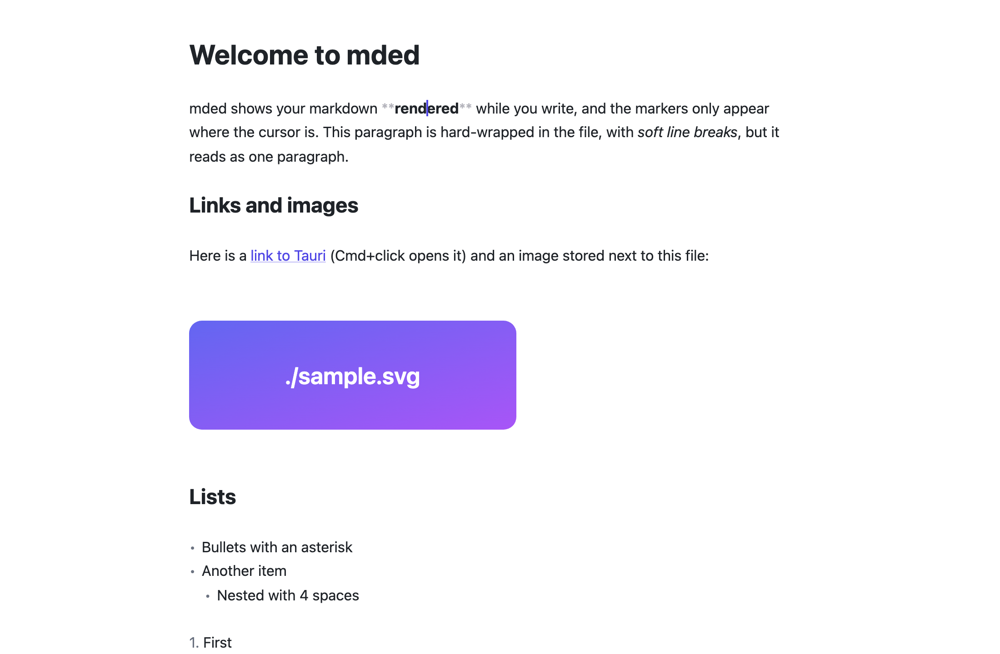

<h1 align="center">mded</h1>

<p align="center">
  <strong>A native markdown editor that shows your text rendered while you write —<br>and saves your file exactly as you wrote it.</strong>
</p>

<p align="center">
  <a href="LICENSE"></a>
  
  
  
</p>

<p align="center">
  <picture>
    <source media="(prefers-color-scheme: dark)" srcset="docs/screenshot-dark.png">
    
  </picture>
</p>

---

## Why mded

Most "WYSIWYG" markdown editors parse your file into a document tree and write it back out when you save. That round trip quietly rewrites your markdown: `-` bullets become `*`, tables get re-padded, escapes disappear, a `Setext` heading turns into `##`. Your git diff fills up with changes you never made.

**mded never does that.** The document *is* your markdown text. Everything you see rendered — headings, bold, links, images, checkboxes — is a visual decoration on top of the text, and the markers reappear, dimmed, wherever your cursor is. Open a file, save it, and it is byte-for-byte identical, line endings included.

## Features

- **Hybrid live preview** in the style of Typora and Obsidian's Live Preview: headings, emphasis, strikethrough, inline code, links, blockquotes, lists, horizontal rules and fenced code blocks with syntax highlighting.
- **Markers on demand** — `#`, `**`, `` ` ``, `[]()` and `>` stay hidden until the cursor enters the element they belong to.
- **Clickable task lists** — ticking a checkbox changes `[ ]` to `[x]` in the text, and nothing else.
- **Inline images**, including paths relative to the file.
- **Reflowed paragraphs** — hard-wrapped lines read as one paragraph, as any renderer would show them, while the file keeps its line breaks. Switchable in *View → Line Breaks*.
- **Cmd+click** on a link opens it in your browser.
- **Light, dark or system theme**, and a choice of text width: *Readable*, *Wide* or *Full*.
- **Safe next to other programs** — if another program changes the open file (another editor, git, a sync client, an AI agent), mded reloads it while you look at it. If you have unsaved changes, it merges the changes made on other lines into your text and highlights them until you save, with a bar that explains what happened; only when both sides touched the same lines does it show a warning bar and let you choose. Saving never overwrites a version of the file you have not seen.
- **Plays well with macOS**: shows up in Finder's *Open With*, accepts files dropped on the window, reopens the last file you were editing, and warns before discarding unsaved changes.
- **Small and fast** — about 5 MB, using the system's WebKit instead of bundling a browser.

## Status

mded is young and is developed **macOS-first**: it is used daily there. It builds for Windows and Linux, but those platforms are untested. There are no signed, prebuilt binaries yet, so for now you build it from source.

What's coming next, and what isn't planned: see the [roadmap](ROADMAP.md).

## Getting started

**Requirements:** [Node.js 24](https://nodejs.org), [pnpm](https://pnpm.io), [Rust](https://rustup.rs) (the exact version is pinned in `src-tauri/rust-toolchain.toml`) and, on macOS, the Xcode Command Line Tools (`xcode-select --install`). See the [Tauri prerequisites](https://tauri.app/start/prerequisites/) for Windows and Linux.

```sh
git clone https://github.com/jamg44/mded.git
cd mded
pnpm install

pnpm app            # run in development mode
pnpm app:install    # macOS: release build, copied to /Applications and registered with Finder
```

After `pnpm app:install`, right-click any `.md` file in Finder → *Get Info* → *Open with: mded* → *Change All…* to make mded the default.

## Development

| Command | What it does |
|---|---|
| `pnpm app` | Runs the app. Frontend changes reload instantly; Rust changes rebuild and restart |
| `pnpm web` | Runs the same editor in a browser at `localhost:1430`, with in-memory files |
| `pnpm check` | Type check, lint (Biome) and unit tests (Vitest) |
| `pnpm e2e` | End-to-end tests (Playwright) against the browser build |
| `pnpm app:build` | Release build (`.app` and `.dmg`) in `src-tauri/target/release/bundle/` |

In VS Code, **Cmd+Shift+B** starts the app.

### How it works

- [`src/editor/hybrid.ts`](src/editor/hybrid.ts) walks CodeMirror's markdown syntax tree and turns it into decorations: hidden ranges, dimmed markers, line styles and widgets. It is a pure function of the editor state, so it is unit-tested without a browser.
- [`src/editor/softbreaks.ts`](src/editor/softbreaks.ts) displays soft line breaks inside a paragraph as spaces.
- [`src/platform/`](src/platform/) isolates everything native — menus, dialogs, file access — behind one interface, with a Tauri implementation and an in-browser one used for development and tests.
- [`src-tauri/`](src-tauri/) is a deliberately thin Rust layer: read and write files, and receive the files Finder asks the app to open.

## Contributing

mded is a personal project that I use every day, and I develop it at my own pace. Bug reports and ideas are welcome as issues. If you want to contribute code, please open an issue first to discuss it: I may decline changes that don't fit where I want to take the project, and I can't promise quick reviews. You are always free to fork it — that's what the MIT license is for.

Whether you contribute or fork, read [AGENTS.md](AGENTS.md) first: it is a guide for both humans and AI coding agents to the architecture, the conventions and a few non-obvious pitfalls. The one rule that is never broken: **the editor must not rewrite the user's markdown.**

## License

[MIT](LICENSE)
